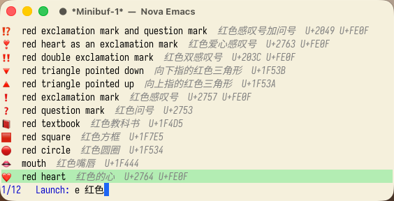

#+TITLE: launcher.el

A Raycast-style launcher for macOS that runs inside Emacs.  One input box
opens applications, finds files, runs system commands, brings back what
you copied, inserts emoji, fills text snippets and searches the web.
Bound to a global hotkey, it pops up over any application and gives the
focus back when you are done.

[[./assets/overview.png]]

This is yibie's fork of [[https://github.com/xiaoxinghu/launcher.el][xiaoxinghu/launcher.el]], by way of tuyafeng's
~develop~ branch.  The core is upstream's; the tools are the ones I use
every day.

* What it does

Type a prefix, a space and a query.  Without a prefix you get
applications, the calculator and your bookmarked sites.

| Input              | Tool                 | Return                                     |
|--------------------+----------------------+--------------------------------------------|
| ~safari~           | applications         | launches the app                           |
| ~12 * 7.5~         | calculator           | copies ~90~                                |
| ~f stackwm readme~ | files                | opens the file                             |
| ~z nova~           | frequent directories | opens the directory in Dired               |
| ~> dark~           | system commands      | toggles dark mode                          |
| ~c~                | clipboard history    | copies the entry again                     |
| ~e heart~, ~e 红色~ | emoji and symbols    | copies the character                       |
| ~t~                | snippets             | fills the placeholders and copies the text |
| ~w emacs~          | multi-engine search  | opens the search                           |
| ~s~                | bookmarked sites     | opens the link                             |

** Files and directories

[[./assets/files.png]]

~f~ finds files in the directories you choose, without Spotlight, ranked
as you type.  ~z~ lists the directories you visit most, from zoxide.

[[./assets/zoxide.png]]

** System commands

[[./assets/system.png]]

~>~ offers 30 macOS commands: dark mode, lock, sleep, restart, shut down,
caffeinate, empty Trash, external IP, System Settings panels and more.
You can add your own.

** Clipboard history

[[./assets/clipboard.png]]

~c~ lists what you copied, in Emacs and elsewhere.  With Embark you can
edit or delete an entry, or join several into one copy.

** Emoji and symbols

[[./assets/emoji.png]]

~e~ finds emoji by their English or Chinese names, and any other Unicode
character by its name.

** Snippets

[[./assets/snippets.png]]

~t~ copies a template from an Org file, after filling placeholders such
as the clipboard, a date or a value it asks you for.

* Before you start

- *macOS only.*  Applications, system commands, emoji names and the
  popup all rely on macOS.
- *Emacs 29 or later*, in a graphical frame for icons and color emoji.
- *Command line tools:* ~f~ needs ~rg~ and ~fzf~; ~z~ needs ~zoxide~.
  Install them with Homebrew.
- *Permissions:* the first time a system command controls Finder or
  System Events, macOS asks whether Emacs may do so.  Lock screen also
  needs Accessibility access for Emacs.
- *Network:* the external IP command asks ~api.ipify.org~.  No other tool
  contacts a server unless you open a site or a search.
- *Private macOS data:* emoji names come from a file inside a private
  macOS framework.  If Apple moves it, ~e~ falls back to English Unicode
  names.
- *A fork:* this branch follows upstream by hand and changes faster than
  it.

* Installation

With Elpaca:

#+begin_src emacs-lisp
(elpaca (launcher :host github :repo "yibie/launcher.el" :branch "main"))
#+end_src

Or with ~use-package~ on Emacs 30:

#+begin_src emacs-lisp
(use-package launcher
  :vc (:url "https://github.com/yibie/launcher.el" :branch "main")
  :bind ("C-c l" . launcher))
#+end_src

Then register the tools you want, each under the prefix you like:

#+begin_src emacs-lisp
(require 'launcher-files)
(require 'launcher-system)
(require 'launcher-clipboard)
(require 'launcher-characters)
(require 'launcher-snippets)
(require 'launcher-web)

(setq launcher-sort-function #'launcher-sort-by-history
      launcher-snippets-file "~/notes/snippets.org"
      launcher-sites-file "~/notes/sites.org"
      launcher-tools
      (list (launcher-sites-tool nil)
            (launcher-sites-tool "s")
            (launcher-web-search-tool "w")
            (launcher-files-tool "f")
            (launcher-zoxide-tool "z")
            (launcher-system-tool ">")
            (launcher-clipboard-tool "c")
            (launcher-characters-tool "e")
            (launcher-snippets-tool "t")))
#+end_src

Run ~M-x launcher~.

* A global hotkey

[[./examples/]] holds the setup behind the screenshots, to copy from:

- [[./examples/init-launcher.el][init-launcher.el]] :: every tool above, registered under its prefix.
- [[./examples/launcher-popup.el][launcher-popup.el]] :: opens launcher in a small frame over any
  application and gives the focus back afterwards.
- [[./examples/raycast/summon-emacs-launcher.sh][raycast/summon-emacs-launcher.sh]] :: a Raycast script command that
  calls it from a hotkey.  [[https://github.com/xiaoxinghu/m-x][M-x.app]] can do the same through an
  ~emacs://~ URL.
- [[./examples/sites.org][sites.org]] and [[./examples/snippets.org][snippets.org]] :: sample sites and templates.

* Documentation

- [[./docs/reference.org][Reference]] :: usage, application discovery, icons, completion and
  how to write your own tools.
- [[./docs/additions.org][Additions in this fork]] :: every option and tool this fork adds.
- [[./docs/development.org][Development]] :: running the tests.
