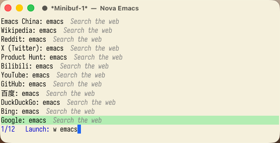
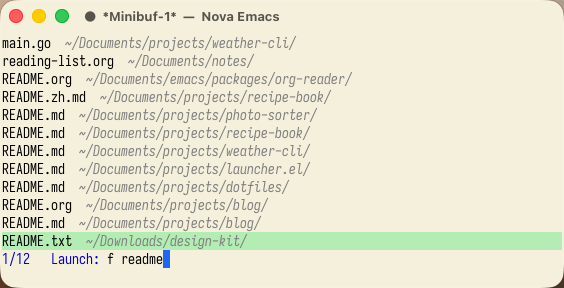
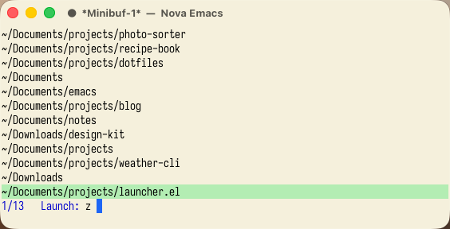
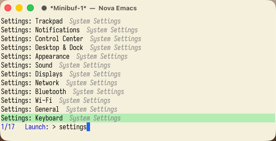
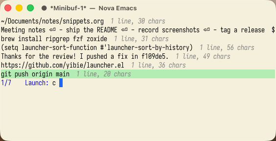
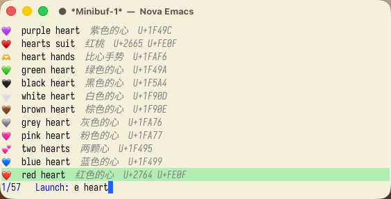
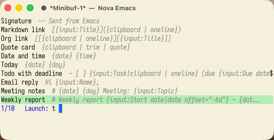

#+TITLE: launcher.el

A macOS launcher for Emacs. Open apps, find files and directories, run system
commands, reuse your clipboard, insert emoji, fill snippets and search the web
from one input box.

This is a fork of [[https://github.com/tuyafeng/launcher.el][tuyafeng/launcher.el]], itself a fork of
[[https://github.com/xiaoxinghu/launcher.el][xiaoxinghu/launcher.el]]. Thanks to Xiaoxing Hu and tuyafeng for the core:
apps, the calculator, web search and the tool interface are theirs. This fork
adds the tools below and a popup you can call from any application.

* Install and launch

Install with Elpaca:

#+begin_src emacs-lisp
(elpaca (launcher :host github :repo "yibie/launcher.el" :branch "main"))
#+end_src

Or with ~use-package~ and ~package-vc~ (Emacs 30):

#+begin_src emacs-lisp
(use-package launcher
  :vc (:url "https://github.com/yibie/launcher.el" :branch "main" :rev :newest)
  :bind ("C-c l" . launcher)
  :custom
  (launcher-app-discovery-method 'filesystem))
#+end_src

Include ~assets/launcher-icons.js~ when installing; it provides native app icons.
Launcher uses your existing completion UI and styles. Vertico, Orderless,
Embark and nerd-icons are optional.

| Command                         | What it does                     |
|---------------------------------+----------------------------------|
| ~M-x launcher~ / ~C-c l~        | Open the launcher                |
| ~M-x launcher-refresh~          | Refresh the app index            |
| ~M-x launcher-files-refresh~    | Rebuild the file list for ~f~    |
| ~M-x launcher-clear-icon-cache~ | Regenerate app icons on next use |

Type to see results, press ~RET~ to run the selected action, or ~C-g~ to cancel.

- ~safari~ finds applications using your completion styles.
- ~12 * 7.5~ previews ~90~; ~RET~ copies the result.
- ~g emacs~ searches Google.
- Any other input with no matches offers a web search.

** Requirements

- macOS and Emacs 29 or later; icons and color emoji need a graphical frame.
- ~rg~ and ~fzf~ for files, ~zoxide~ for directories: ~brew install ripgrep fzf zoxide~.
- The first time a system command controls Finder or System Events, macOS asks
  whether Emacs may do so. Locking the screen also needs Accessibility access.

* Tools in this fork

Register the tools you want, each under a prefix of your choice:

#+begin_src emacs-lisp
(with-eval-after-load 'launcher
  (require 'launcher-files)
  (require 'launcher-system)
  (require 'launcher-clipboard)
  (require 'launcher-characters)
  (require 'launcher-snippets)
  (require 'launcher-web)
  (setq launcher-sort-function #'launcher-sort-by-history
        launcher-tools
        (list (launcher-sites-tool nil)       ; sites beside apps
              (launcher-sites-tool "s")
              (launcher-web-search-tool "w")
              (launcher-files-tool "f")
              (launcher-zoxide-tool "z")
              (launcher-system-tool ">")
              (launcher-clipboard-tool "c")
              (launcher-characters-tool "e")
              (launcher-snippets-tool "t"))))
#+end_src

| Input              | Tool                 | ~RET~                                      |
|--------------------+----------------------+--------------------------------------------|
| ~f stackwm readme~ | files                | opens the file                             |
| ~z nova~           | frequent directories | opens the directory                        |
| ~> dark~           | system commands      | toggles dark mode                          |
| ~c~                | clipboard history    | copies the entry again                     |
| ~e heart~, ~e 红色~ | emoji and symbols    | copies the character                       |
| ~t~                | snippets             | fills the placeholders and copies the text |
| ~w emacs~          | multi-engine search  | opens the search                           |
| ~s~                | bookmarked sites     | opens the link                             |

** Files and directories

~f~ searches the files under ~launcher-files-directories~ without Spotlight.
ripgrep lists them once in the background, and ~fzf --filter~ ranks the list as
you type, in about 50 ms for 280,000 files. ~z~ lists the directories zoxide
knows, most used first.

#+begin_src emacs-lisp
(setq launcher-files-directories '("~/Documents" "~/Downloads")
      ;; Open directories in Dired instead of Finder.
      launcher-zoxide-open-function #'launcher-files-open-in-emacs)
#+end_src

** System commands

~>~ lists 30 macOS commands: dark mode, display sleep, hidden files, lock,
sleep, restart, shut down, log out, caffeinate, empty Trash, version, hardware,
external IP and System Settings panels. Restart, shut down, log out and empty
Trash ask first. Add your own:

#+begin_src emacs-lisp
(launcher-system-define "Flush DNS" :shell "dscacheutil -flushcache")
#+end_src

The external IP command asks ~api.ipify.org~; no other command uses the network.

** Clipboard history

~c~ lists the kill ring, newest first, with what other applications copied
folded in. With Embark:

| Keys                          | What it does                          |
|-------------------------------+---------------------------------------|
| ~C-. e~                       | Edit the entry; ~C-c C-c~ saves it    |
| ~C-. d~                       | Delete the entry from the kill ring   |
| ~C-. SPC~ on entries, ~C-. A j~ | Join them, in order, into one copy  |

** Emoji and symbols

~e~ finds emoji by the names macOS ships, in English and Chinese, and any other
Unicode character by its name. ~launcher-characters-emoji-languages~ picks the
name languages. The names come from a private macOS framework; if Apple moves
it, ~e~ falls back to English Unicode names.

** Snippets

~t~ lists the headings of ~launcher-snippets-file~ and copies a body after
filling its placeholders:

#+begin_src org
,* Reply later
Thanks, {input:Name}. I'll get back to you by {date offset="+2d"}.
#+end_src

Other placeholders include ~{clipboard}~, ~{choice:Tone|Formal,Casual}~ and
~{snippet:Signature}~. See [[file:examples/snippets.org][examples/snippets.org]] for all of them.

** Sites and web search

~s~ lists the links in ~launcher-sites-file~, an Org file grouped by headings;
~(launcher-sites-tool nil)~ also offers them beside apps. ~w~ shows one search
per engine in ~launcher-web-search-engines~. See [[file:examples/sites.org][examples/sites.org]].

* Settings worth knowing

Use ~M-x customize-group RET launcher RET~ to browse all options.

| Option                              | Purpose / default                                                |
|-------------------------------------+------------------------------------------------------------------|
| ~launcher-app-discovery-method~     | ~spotlight~ by default; ~filesystem~ scans app directories       |
| ~launcher-sort-function~            | ~launcher-sort-by-history~ puts recent picks first; ~nil~         |
| ~launcher-files-directories~        | Where ~f~ searches; ~~/Documents~ and ~~/Downloads~               |
| ~launcher-files-open-function~      | Opens files; macOS ~open~ by default                             |
| ~launcher-zoxide-open-function~     | Opens directories; ~nil~ uses the file function                  |
| ~launcher-files-refresh-interval~   | Seconds before the file list is rebuilt; 900                     |
| ~launcher-snippets-file~            | Org file of snippets; ~snippets.org~ in your Emacs directory      |
| ~launcher-sites-file~               | Org file of sites; ~sites.org~ in your Emacs directory            |
| ~launcher-web-search-engines~       | Engines for ~w~; Google, Bing and others                         |
| ~launcher-clipboard-join-separator~ | Text between joined entries; a newline                           |
| ~launcher-after-copy-hook~          | Runs after a tool copies its result                              |
| ~launcher-display-buffer-function~  | Shows a buffer a result returns                                  |

To save recent selections across restarts:

#+begin_src emacs-lisp
(with-eval-after-load 'savehist
  (add-to-list 'savehist-additional-variables 'launcher-selection-history))
(savehist-mode 1)
#+end_src

* Define a tool

A tool defines the results to show and what to do when one is selected:

#+begin_src emacs-lisp
("prefix" :name "Tool name"
          :candidates my-candidates  ; List, or a function taking no arguments
          :query my-query           ; Function taking the query string
          :submit my-submit         ; Function taking the selected candidate
          :debounce 0.2             ; Optional delay for :query, in seconds
          :icon "...")              ; Optional icon, inherited by candidates
#+end_src

Each candidate is a plist such as
~(:id unique-id :title "Visible title" :subtitle "Detail" :data value)~.
~:submit~ returns ~nil~ after an action, a buffer to show,
~(:buffer BUFFER :action ACTION)~ to show it with a ~display-buffer~ action,
~(:input STRING)~ to
keep the launcher open with new input, or, in this fork, a function to call
after the launcher closes. See [[file:docs/reference.org][the reference]] for every rule and more examples.

* Use a global shortcut

[[file:examples/launcher-popup.el][examples/launcher-popup.el]] opens the launcher in a small frame over any
application. Cancelling, or a tool that only copies, gives the focus back so you
can paste right away. Start an Emacs server, load that file, and bind a global
shortcut that runs:

#+begin_src sh
emacsclient -e '(my/launcher-popup)'
#+end_src

[[file:examples/raycast/summon-emacs-launcher.sh][examples/raycast/summon-emacs-launcher.sh]] does this as a Raycast script
command; [[https://github.com/asmvik/skhd][skhd]] or [[https://github.com/xiaoxinghu/m-x][M-x.app]] work too. [[file:examples/init-launcher.el][examples/init-launcher.el]] is the
full setup behind the screenshots.

* More documentation and development

- [[file:docs/reference.org][Reference]]: application discovery, icons, completion and the tool interface.
- [[file:docs/additions.org][Additions in this fork]]: every option and tool this fork adds.
- [[file:docs/development.org][Development]]: running the tests.
